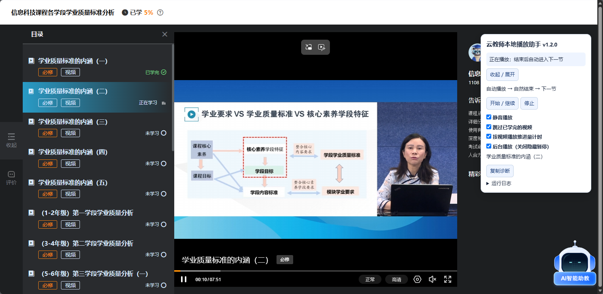
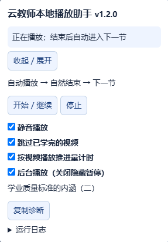
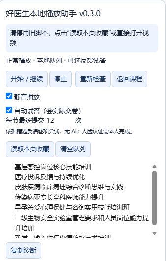

# CoursePlayer · 本地网课播放助手

## 运行截图

云教师课程播放与助手运行效果：



| 云教师助手面板 | 好医生助手面板 |
| --- | --- |
|  |  |

适用于 **Microsoft Edge + Tampermonkey（油猴）+ Global Speed** 的浏览器用户脚本，提供连续播放、章节切换与播放状态提示。两个平台分别安装对应脚本，不需要安装 Node.js、Python、Playwright，也不需要启动无头浏览器。

“本地”指助手不依赖第三方授权服务或 AI 服务；登录、视频、进度和考试仍正常连接所属平台服务器。是否计入学习时长、是否通过考试及是否完成课程，以平台记录为准。

## 脚本与安装入口

| 平台 | 版本 | 源码 | 直接安装 |
| --- | --- | --- | --- |
| 好医生继续医学教育 | v0.3.0 | [cme-local.user.js](cme-local.user.js) | [安装好医生助手](https://raw.githubusercontent.com/mayJ1/CoursePlayer/refs/heads/main/cme-local.user.js) |
| 云教师 / 云继教网 | v1.2.0 | [yunteacher-local.user.js](yunteacher-local.user.js) | [安装云教师助手](https://raw.githubusercontent.com/mayJ1/CoursePlayer/refs/heads/main/yunteacher-local.user.js) |

好医生匹配 `https://www.cmechina.net/*`，云教师匹配 `https://saas.yunteacher.com/*`。脚本不会在任意网课网站上通用运行。

## 让 AI Agent 帮你适配其他网课平台

如果你使用的是其他平台，可以把本仓库的两个 `.user.js` 源码文件发给你的 AI Agent，并提供目标平台名称、课程播放页链接、页面截图和希望实现的功能，让它参考现有框架编写对应平台的版本。

这些脚本可供参考的部分包括：助手面板、播放与切集流程、单标签页运行锁、进度确认、请求排队和诊断信息。**不同平台的目录结构、播放器 SDK、接口与完成条件并不相同，不能只替换网址就认为适配成功。** 如需登录，由你在本机完成；不要把密码、Cookie、登录票据或二维码放进提示词或公开仓库。

下面的提示词可以直接复制，替换方括号中的内容，并附上脚本文件：

```text
请先阅读cme-local.user.js 和 yunteacher-local.user.js源码，再为我需要的网课平台编写一个独立的本地播放助手。

目标平台：[平台名称]
课程播放页：[课程链接]
运行环境：Windows + Microsoft Edge + Tampermonkey；倍速由 Global Speed 扩展控制。
需要实现：[例如：自动播放、视频自然结束后进入下一节、播放状态提示、复制诊断]
补充资料：[页面截图、目录结构、遇到的提示或错误；没有的请说明需要我补充什么]

请按以下要求完成：
1. 先分析目标平台的页面结构、播放器、章节切换入口和官方完成条件；
   不要直接照搬原平台的选择器、接口或计时规则，也不要只修改匹配网址。
2. 实现正常播放和自然结束后的切集。区分“视频播完”“请求已发送”和
   “平台已确认完成”，以官方返回的状态为准，不伪造时长或完成记录。
3. 运行时使用本地 JavaScript，不持续调用 AI，不接入第三方授权服务。
   只申请必要的网站权限，兼容 Global Speed，但不要假设任意倍率都受平台支持。
4. 如涉及进度请求，先核实接口语义和频率限制；处理排队、失败、超时与
   未确认结果，不盲目重发，并在需要保持页面打开时明确提示。
5. 防止多个标签页同时驱动播放；认证、验证码、考试与其他本人确认环节
   默认留给我处理，不绕过平台限制，不擅自启用自动交卷。
6. 提供开始、停止、状态提示和脱敏诊断；不要输出账号凭据或视频授权地址。
7. 先做本地模拟测试；需要真实账号或无头 Edge 验证时先告诉我测试范围，
   我会在本机完成登录并暂停其他设备的播放。测试结束后关闭测试浏览器。
8. 最后交付完整 .user.js 文件、中文安装配置步骤、验证结果和已知限制。

如果缺少必要信息，请先列出具体需要我提供的内容；不要猜测接口或声称未经验证的功能已经可用。
```

AI 生成的适配版本仍需审核与实测；请只在本人有权访问的课程中使用，并遵守平台和培训项目要求。

## 一、准备 Edge 和扩展

### 1. 安装 Microsoft Edge

使用 Windows 桌面版 [Microsoft Edge](https://www.microsoft.com/edge)。本项目以 Edge 为使用与验证环境，其他浏览器、手机浏览器不作兼容保证。

### 2. 安装 Tampermonkey（油猴）

1. 在 Edge 打开 [Tampermonkey 官方网站](https://www.tampermonkey.net/index.php?browser=edge)，按官方入口进入 Edge 扩展商店安装。
2. 在地址栏输入 `edge://extensions/`，确认 Tampermonkey 已启用。
3. 如果扩展详情里有“允许用户脚本”，打开该开关；如果没有该选项，按当前 Edge 界面启用“开发人员模式”。不同版本的开关位置可能不同，参见 [Tampermonkey 官方权限说明](https://www.tampermonkey.net/faq.php?q=Q209)。
4. 在扩展“站点访问权限”中，允许 Tampermonkey 访问你要使用的平台域名。无需为了本项目授予其他无关网站权限。
5. 在 Edge 工具栏的扩展菜单中，将 Tampermonkey 固定到工具栏，方便查看脚本是否执行。

### 3. 安装 Global Speed 倍速扩展

1. 在 Edge 打开 [Global Speed 扩展商店页面](https://microsoftedge.microsoft.com/addons/detail/mjhlabbcmjflkpjknnicihkfnmbdfced)，确认发布者为 **polywock** 后安装。扩展源码见 [Global Speed 官方仓库](https://github.com/polywock/globalSpeed)。
2. 确认 Global Speed 已启用并固定到工具栏，允许它访问对应课程网站。
3. 打开课程视频后点击 Global Speed，先选择 **1 倍速**，确认视频、声音和平台进度均正常，再按平台允许的范围调整倍率。
4. 如只希望课程网站倍速，可在 Global Speed 的设置中使用网址规则；不要把希望使用的课程倍率无意应用到所有网站。

**职责区分：油猴负责运行本仓库脚本；Global Speed 负责改变播放倍率。脚本本身不提供倍速输入框，不替代 Global Speed。**

播放器可能有自己的倍速限制。装好扩展不代表所有课程都允许任意倍率；若播放器报错、暂停或消失，请先恢复 1 倍速、刷新页面并检查平台提示。不要同时启用多个倍速扩展或多个同平台自动播放脚本。

## 二、安装两个助手

按需安装一个或两个脚本；两者通过网站域名区分，不需要在同一课程上同时运行。

### 方法 A：点击安装入口

1. 安装并启用 Tampermonkey 后，点击上方表格中的“直接安装”。
2. 若出现油猴安装界面，核对名称、匹配域名及版本号，点击安装。
3. 刷新已经打开的课程页面，确认出现对应助手面板。

### 方法 B：手动复制源码

如果点击链接只显示源码，没有弹出油猴安装界面：

1. 打开相应 `.user.js` 文件，点击 GitHub 的 **Raw** 查看原始代码，复制全部内容。
2. 点击 Tampermonkey →“添加新脚本”。
3. 删除编辑器默认内容，粘贴完整源码，按 `Ctrl + S` 保存。
4. 确认脚本处于启用状态，回到课程页刷新。

安装前先停用同平台的旧脚本，避免重复点击、抢占播放或重复提交。更新时覆盖原脚本即可，不要保留同一助手的多个启用副本；有进度排队时请先等队列处理完再更新、刷新。

## 三、好医生 v0.3.0 使用步骤

1. 在 Edge 中登录好医生，打开[我的收藏](https://www.cmechina.net/cme/myFavorite.jsp)。
2. 确认页面出现“好医生本地播放助手 v0.3.0”面板。
3. 在收藏页点击“开始 / 继续”，助手会读取收藏课程并开始按队列处理；也可以先点“读取本页收藏”，再选择课程进入。
4. 如果直接打开课程或视频页，也可以点击“开始 / 继续”。当前课程完成后，助手会尝试补全收藏队列并按顺序进入后续课程。
5. 如提示没有识别到章节，手动打开第一节视频后再次检查；如浏览器阻止自动播放，手动点击一次网站播放按钮。
6. 默认手动答题。视频结束后助手会等待平台保存状态，再处理章节或提示你完成答题。人工完成后可点击“重新检查”。
7. 只有平台状态确认当前课程完成后，才继续队列中的下一门；没有后续课程时停止。

收藏顺序、课程解锁条件和网站认证要求仍由平台决定。此版本仅读取能识别的收藏分页和章节结构，不承诺适配所有课程模板。

### 可选：自动试答

面板中的“自动试答（会实际交卷）”默认关闭。确需启用时，勾选并设置每节最多提交次数，再点击“开始 / 继续”；默认 12 次，最高 120 次。

该功能依据平台返回的逐题正误反馈保留正确选项、调整错误选项，失败后等待约 3 秒再尝试；它不理解题目含义，不调用 AI 或远程题库。缺少可识别反馈、达到次数上限、认证未完成或接口异常时暂停。

**这会真实提交答卷，已经到达服务器的提交无法撤回。请遵守所在平台与培训项目的要求，自行决定是否启用。** 人脸认证、验证码及其他本人确认环节需要本人处理，不保证考试通过或获得学分。

## 四、云教师 / 云继教网 v1.2.0 使用步骤

1. 在 Edge 中登录云继教网，打开 `https://saas.yunteacher.com/coursePlay` 对应的课程播放页。
2. 确认出现“云教师本地播放助手 v1.2.0”面板。默认启用；若已停止，点击“开始 / 继续”。
3. 先以 1 倍速确认播放和目录识别正常，再通过 Global Speed 调整倍率。
4. 视频自然结束后，助手等待进度请求确认，并核对平台是否返回“已学完”，再自动进入后续视频。
5. **如果提示“进度排队确认”，保持当前页面打开等待，不要马上重看、刷新、关闭标签页或退出登录。**

默认设置：

| 选项 | 默认状态 | 说明 |
| --- | --- | --- |
| 静音播放 | 开启 | 需要声音时取消勾选 |
| 跳过已学完的视频 | 开启 | 希望重看时取消，再点击“开始 / 继续” |
| 按视频播放推进量计时 | 开启 | 跟随实际播放推进量累计；拖动跳转不计入 |
| 后台播放（关闭隐藏暂停） | 开启 | 移除已适配课程组件的页面隐藏暂停回调；停止或取消选项时恢复 |

### 为什么播完还要等？

10 倍速下，每推进约 60 秒视频可能仅经过约 6 秒。实测这种短间隔上报有请求被平台提示“多页面或多设备学习无效”，不能把“视频已经播完”直接当作“时长已经记入”。

v1.2.0 将平台已有进度请求按**至少 15 秒间隔**串行排队，并检查接口响应。高倍速播放时可能产生待发进度，视频结束后需要等待队列确认。因此，总耗时不一定等于“视频长度 ÷ 倍率”。15 秒是本次验证采用的保守间隔，不是平台对所有账号、课程的规则保证。

其他注意事项：

- 接口拒绝或网络结果不明时，助手会保留未确认信息并暂停自动操作，不盲目重发；先查看平台记录并复制诊断。
- 点击“停止”会暂停播放和切集，但已观看内容的排队请求仍会继续处理。仍有队列时应保持页面打开。
- 队列保存在当前页面内存中；强行关闭、刷新、浏览器崩溃可能使尚未发送的进度丢失，不会在新页面中自动补记。
- 正式脚本不安装或修改 Global Speed，不改变播放器 SDK 自身的倍速配置，也不保证任意高倍率都可用。
- 不自动完成认证、问答、评价或文档任务，也不直接把网站的完成状态改成“已完成”。

## 五、常见问题

### 油猴显示“此脚本尚未执行”或没有助手面板

检查 Tampermonkey 是否启用、用户脚本权限/开发人员模式是否开启、站点访问权限是否允许、脚本是否保存并启用，然后刷新页面。还要确认地址域名与安装表中的匹配域名一致；登录跳转页、其他域名或内嵌跨域页面可能不在匹配范围内。

### 提示多页面、多设备登录，学习无效

只保留一个课程播放标签页，暂停其他浏览器、其他设备及无头测试浏览器中的学习。不要用多个标签页并行播放。此提示也可能与请求间隔有关，不能仅凭文字判断确实存在第二台设备；若仍出现，请暂停操作、核对平台记录并提供诊断。

### 视频播完仍显示“未学完”

云教师先等进度队列完成；好医生则核对是否仍需章节答题、认证或目录状态同步。失败过的进度不会因为更新脚本而凭空补回。若仍未完成，按平台提示处理，不要反复无间隔点击开始、交卷或刷新。

### 切换窗口、最小化或电脑休眠后不能继续

云教师的后台播放选项仅针对已识别的前端隐藏暂停逻辑。电脑休眠、断网、浏览器冻结标签页及系统节流仍会影响播放；好医生不承诺具备同样的后台播放能力。

### 怎样反馈问题？

在助手面板点击“复制诊断”，连同脚本版本、发生步骤、课程页面路径和提示文字提交到 [Issues](https://github.com/mayJ1/CoursePlayer/issues)。发布前自行检查内容，**不要上传 Cookie、登录票据、密码、二维码、身份证信息或完整抓包文件**。

## 六、数据与验证范围

- 设置、课程队列和运行状态保存在对应网站的浏览器存储中；清除网站数据会清除相关本地配置。
- 两个助手均不依赖作者的 Pro Token、第三方授权服务或 AI 接口，网站本身仍需正常登录与联网。
- 云教师 v1.2.0 已进行浏览器模拟测试及本人授权课程的真实接口、进度入账和剩余段结束确认验证；并未直接加载 Global Speed 扩展做完整平台兼容认证。
- 好医生的页面模板、考试表单与平台规则可能变化，需要结合实际页面诊断；不以本仓库说明替代平台自身记录。
- 本仓库仅发布两个用户脚本及使用说明，不包含账号登录状态、个人课程记录、测试二维码和视频资源。

请仅在本人有权访问的课程中使用，并遵守平台规则及学习要求。项目不隶属于好医生、云继教网、Microsoft、Tampermonkey 或 Global Speed。
